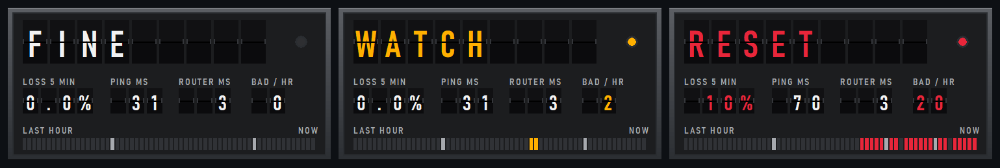

# Netwatch

A small desktop board for Windows that tells you whether your internet has been dropping packets badly enough in the last hour to be worth restarting the router.



Once a second it sends a tiny DNS lookup to 1.1.1.1 and 8.8.8.8 and pings your router. A minute counts as bad when both hosts missed three replies in it, and the board says RESET after three bad minutes in the hour with one in the last 10. The lookups go over UDP like game traffic, because pings get throttled on their own (in testing each host ignored pings for 30 seconds every half hour while lookups went straight through). A router that answers while the internet doesn't means the loss is past it.

The top row is the verdict, from CLEAN and FINE through WATCH to RESET, then RECOVERY once it has been quiet for a while. Under it are the loss over 5 minutes, the ping to the internet and to the router, and the bad minutes this hour. The bottom strip is the hour, one cell per minute.

It sits on the desktop under your windows, so it never covers a game, and uses about 2 MB of memory and 260 bytes a second. The hour is kept on disk, so a reboot doesn't lose it.

Click the board, or open Netwatch again while it's running, for the settings. They cover what counts as bad, which rows show, the size, the flip animation and starting with Windows, and there's Clear the Hour for after a restart. Drag the board to move it.

## Building

It needs Rust and nothing else, as it calls Win32 directly.

```
cargo build --release
```

That gives you `target\release\netwatch.exe`, which keeps its settings and the last hour in `%LOCALAPPDATA%\Netwatch`. It won't fix the connection. It only tells you when a restart is worth a try.
