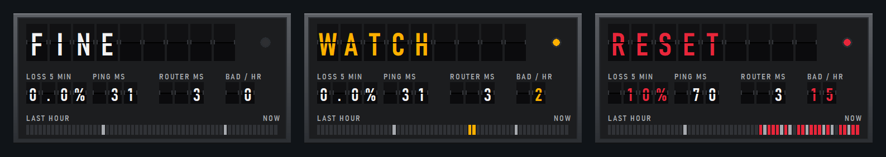

# Netwatch

A small desktop board for Windows that tells you whether your internet has been dropping packets badly enough in the last hour to be worth restarting the router.



Twice a second it sends a tiny DNS lookup to 1.1.1.1 and 8.8.8.8, and once a second it pings your router. A minute counts as bad when both hosts missed lookups in it and the two together missed five, which is what a burst of a couple of seconds does to a game. The board says RESET after five bad minutes within 15, since a line that stutters now and then is still playable and one that misses minute after minute isn't. The lookups go over UDP like game traffic, because pings get throttled on their own. A router that answers while the internet doesn't means the loss is past it.

The top row is the verdict, from CLEAN and FINE through WATCH to RESET, then RECOVERY once it has been quiet for a while. Under it are the loss over 5 minutes, the ping to the internet and to the router, and the bad minutes this hour. The bottom strip is the hour, one cell per minute.

There are also rows for the PC itself, with download and upload speed, CPU and RAM, and GPU and battery, all off until you turn them on. GPU reads the same as Task Manager.

It sits on the desktop under your windows, so it never covers a game, and uses well under 1 MB of memory and 460 bytes a second. The GPU row costs another 4 MB or so, as Windows' counters for it are fairly heavy.
Click the board, or open Netwatch again while it's running, for the settings. They cover what counts as bad and what the board shows, and there's Clear the Hour for after a restart. Drag the board to move it.

## Building

It needs Rust and nothing else, as it calls Win32 directly.

```
cargo build --release
```

That gives you `target\release\netwatch.exe`, which keeps its settings in `%LOCALAPPDATA%\Netwatch`. It won't fix the connection. It only tells you when a restart is worth a try.
